<div align="center">



<a href="https://linkedin.com/in/sj969"></a>
<a href="mailto:sjaiswalnetwork@gmail.com"></a>


</div>


```diff
+ STRATEGY & OPERATIONS WORK — WITH AI
  4+ years across pharma manufacturing, distribution and B2B sales.
  Map the process on the ground → find the root cause → pick the right-sized fix:
  process redesign · no-code automation · generative AI (LLMs, agents, MCP)
```

- 🏭 Driving a **35+ initiative AI & automation roadmap** across finance, sales, production and CX
- 🔌 Built **MCP servers** for Tally and Runo CRM so leadership can query live business data in plain English
- 🎧 AI call-audit pipeline: **900 calls/day** reviewed in **1h 40m** instead of 6–7 hours
- 📊 Live Balanced Scorecard: **22 KPIs**, replaced a 15+ spreadsheet leadership review, zero BI licence cost
- 🎓 **8 Anthropic Claude Academy** certifications (Sep 2026)




<div align="center">
<a href="https://github.com/sjaiswalnetwork/tally-mcp"></a>
<a href="https://github.com/sjaiswalnetwork/screen-time-tracker"></a>
<br/>
<a href="https://github.com/sjaiswalnetwork/sj-buddy"></a>
<a href="https://github.com/sjaiswalnetwork/claude-pulse"></a>
<br/>
<a href="https://github.com/sjaiswalnetwork/kart-arena"></a>
<a href="https://github.com/sjaiswalnetwork/excuse-generator"></a>
<br/>

<sub><code>LIVE ↗</code> <a href="https://sjaiswalnetwork.github.io/screen-time-tracker/">screen-time-tracker</a> · <a href="https://sjaiswalnetwork.github.io/claude-pulse/">claude-pulse</a> · <a href="https://sjaiswalnetwork.github.io/excuse-generator/">excuse-generator</a></sub>
</div>


<div align="center">

**`// AI & AUTOMATION`**
<p>


</p>

**`// DATA & BI`**
<p>


</p>

**`// BUSINESS SYSTEMS`**
<p>


</p>

**`// BUILD`**
<p>


</p>

</div>


| Issuer | Courses |
|---|---|
| 🟣 **Anthropic Claude Academy** (Sep 2026) | Building with the Claude API · MCP: Advanced Topics · Intro to MCP · Claude Code in Action · Claude Code 101 · Claude Platform 101 · Intro to Claude Cowork · Claude 101 |
| 🔵 **LinkedIn Learning** | What Is Generative AI? (Microsoft × LinkedIn) · Generative AI & Workplace Transformation · Project Management Power Moves |
| 🟡 **AI Business Partners** | AI-Ready Business Leader (May 2026) |




<div align="center">


<br/>

<br/>

<br/>

</div>

<br/>
